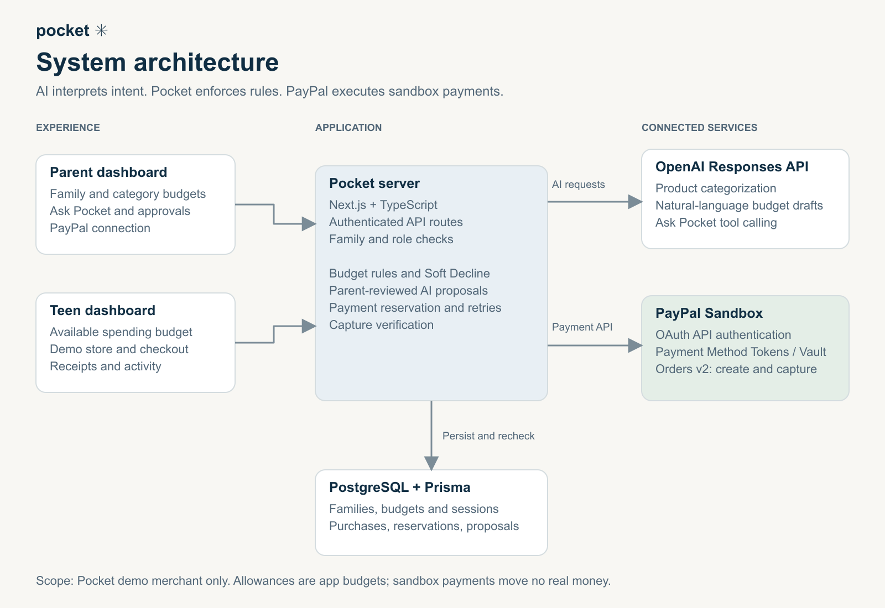
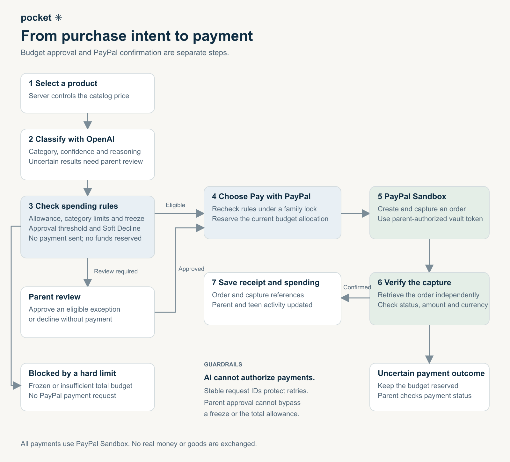

# Pocket

A PayPal sandbox + OpenAI prototype for parent-guided spending, built with Next.js App Router, TypeScript, PostgreSQL, and Prisma.

Source code: [public GitHub repository](https://github.com/Amaru333/paypal-hackathon). Licensed under the [MIT License](LICENSE), an [OSI-approved license](https://opensource.org/license/mit).

## Technologies and integrations

- **Next.js App Router, React, and TypeScript:** parent and teen interfaces, authenticated server routes, and payment orchestration on Node.js.
- **PostgreSQL and Prisma:** persistent accounts, budgets, invitations, purchase history, and transaction-backed spending reservations.
- **PayPal Sandbox:** OAuth API authentication, Payment Method Tokens / Vault for parent-authorized payment methods, and Orders v2 for creating, capturing, and verifying purchases.
- **OpenAI Responses API:** structured product classification and budget drafts, plus function calling for the parent assistant. The default model is `gpt-4.1-mini`; model settings are configurable.
- **Tailwind CSS, Radix UI, Lucide, and Sonner:** interface styling, accessible primitives, icons, and notifications. Zod validates request and AI data.
- **Resend:** optional invitation email delivery using a verified sender domain.
- **Render (hackathon sponsor):** hosts the deployed application. The project owner uses a $7/month paid plan; this is the project's selected plan, not a current pricing guarantee or a requirement to run locally.
- **OpenAI Codex:** assisted with implementation, debugging, testing, and documentation during development.

## System architecture

Parent and teen dashboards communicate with Pocket's authenticated server. OpenAI interprets spending intent and prepares suggestions; server-side rules enforce budgets and permissions. PostgreSQL and Prisma persist family data and purchase reservations, while PayPal Sandbox handles authorized payments.



See the [architecture guide](docs/architecture.md) for implementation details.

## Purchase flow

Pocket classifies a selected product and checks spending rules before sending a payment. Eligible purchases proceed through a budget recheck, reservation, PayPal order creation and capture, and independent capture verification. Purchases requiring approval go to the parent; hard limits block payment. Uncertain payment outcomes remain reserved for reconciliation.



See the [checkout walkthrough](docs/checkout-demo.md) for a step-by-step sandbox demo. All payments use sandbox funds; no real money or goods are exchanged.

## Quick start

Use Node.js 22.12+ (Node 24 recommended), npm, and PostgreSQL 16 or newer.

Clone the repository and enter the project directory:

```sh
git clone https://github.com/Amaru333/paypal-hackathon.git
cd paypal-hackathon
```

1. Run `npm install` and `npm run db:generate`.
2. Copy `.env.example` to `.env` **only if `.env` does not already exist**. Configure `DATABASE_URL`, PayPal sandbox credentials, and optionally `OPENAI_API_KEY`.
3. Run `npm run db:migrate` to apply the checked-in migrations.
4. Run `npm run dev` and open http://localhost:3000/signup. On this workstation, use `npm run dev:local` to start both the project PostgreSQL cluster and Next.js. Use it again after a reboot; starting Next.js alone does not start PostgreSQL.

On this Windows workstation, PostgreSQL 18 is installed. `npm run db:local` starts an isolated project cluster on **127.0.0.1:55432**, creates `pocket` and `pocket_test`, and adds missing database URLs to `.env`. It does not modify the system PostgreSQL service. Set `PG_BIN` for a different installation. Run `npm run db:stop` to stop this cluster. Local cluster data and credentials are under ignored `.local/` paths.

Alternatively, connect an existing PostgreSQL database using `DATABASE_URL`. Never point integration tests at your development or production database.

### Configure the integrations

Use [.env.example](.env.example) as the configuration reference. Keep all credentials server-side.

- **Database:** create a PostgreSQL database and set `DATABASE_URL` to its connection string. Set `TEST_DATABASE_URL` to a separate database ending in `_test` only when running integration tests.
- **PayPal:** create a sandbox REST application in your PayPal Developer account and set `PAYPAL_CLIENT_ID` and `PAYPAL_CLIENT_SECRET` from that application. Keep its business merchant separate from the personal sandbox buyer used during consent. Sign in to Pocket as a parent and connect that buyer from **Budgets** before testing payments. See [checkout setup and walkthrough](docs/checkout-demo.md).
- **AI:** set `OPENAI_API_KEY` to exercise live AI features. `OPENAI_MODEL` defaults to `gpt-4.1-mini`; `OPENAI_ASSISTANT_MODEL` optionally overrides the parent assistant model. Without a key, live AI drafting/chat is unavailable and fallback classification is explicitly labeled.
- **Invitations:** optionally set `RESEND_API_KEY` and `EMAIL_FROM` for invitation emails. See [email setup](docs/email-setup.md). Copyable invitation links remain available when email is not configured.
- **Hosted origin:** set `APP_URL` to the exact HTTPS origin of the deployed application, without a path, so invitation links and request-origin checks use the correct host.

### Hosting on Render

The hosted demo runs on Render. To reproduce the deployment, connect this repository to a Node.js Web Service, provide a reachable PostgreSQL database, and configure the environment variables above in Render's environment settings.

- Build command: `npm ci && npm run db:generate && npm run db:migrate && npm run build`
- Start command: `npm run start -- --hostname 0.0.0.0 --port $PORT`
- Use Node.js 24 and set `APP_URL` to the service's public HTTPS origin.

Migrations require database connectivity during the build. For deployments with a separate release/pre-deploy phase, run `npm run db:migrate` there before starting the new application version. The local PostgreSQL helper is for local development; configure the hosted database independently.

## Project organization

```text
prisma/
  schema.prisma              Relational models and indexes
  migrations/                Versioned SQL, including domain constraints
prisma.config.ts             Prisma CLI configuration
src/
  app/
    (auth)/                  Login, signup, invitation pages
    (dashboard)/             Shared layout and protected parent/child routes
    api/                     Small endpoint files: validation, auth, service calls
  components/                Shared presentation components
  domain/                    Pure budget rules, money types, demo catalog
  features/
    auth/                    Authentication and invitation screens
    dashboard/               Dashboard state, typed API client, routed views
    family/                  Child list and invitation UI
    purchases/               Purchase history components
  lib/                       Browser-safe utilities
  server/
    auth/                    Password hashing and session identity
    db/                      Prisma singleton, transactions, model mappers
    http/                    Request validation, CSRF, sanitized error responses
    integrations/            PayPal sandbox and OpenAI adapters
    services/                Application operations and ownership checks
  generated/prisma/          Generated client; ignored by Git
scripts/                     Local database, legacy import, PayPal diagnostics
tests/
  unit/                      Pure budget rule tests
  integration/               Real PostgreSQL tests through API handlers
```

See [architecture](docs/architecture.md) and [API routes](docs/api.md). Route files should stay small; put business rules in the domain/services layers. UI code must not import `src/server` or generated Prisma code. Database access stays on the server, and external network calls stay outside transactions.

## User flow and routes

- `/signup`: create a parent account without creating a child. Multiple independent families are supported.
- `/login`: parent email/password or child username/password.
- `/parent/family`: add children and manage single-use invitations, valid for 24 hours.
- `/invite#invite=...`: child chooses their own username/password. Tokens are hashed in the database and kept out of request URLs.
- `/parent/children/[childId]/overview`, `/budgets`, `/requests`, `/activity`: manage a selected child.
- `/child/overview`, `/child/shop`, `/child/activity`: the child's pocket and demo store.

For a local demo, open a child's invitation in a private browser window on the **same computer**. Invitation email delivery is available when Resend is configured; otherwise copy the invitation link. Parent email is a login identifier; it is not verified. Invitation renewal invalidates the previous link. Child usernames are globally unique.

## Payments and AI

Parents connect a **personal sandbox buyer account** through PayPal, distinct from the sandbox business merchant. PayPal OAuth, vault setup/payment tokens, and Orders v2 support subsequent purchases through the demo merchant. All PayPal requests are hardcoded to the sandbox host.

### How PayPal is used

The server obtains OAuth access tokens to authenticate PayPal API requests. Parent consent and the Payment Method Tokens API establish a vaulted sandbox payment method. After Pocket validates and reserves an eligible purchase, Orders v2 creates and captures the payment. Pocket independently retrieves the order and checks capture status, amount, and currency before showing a confirmed payment receipt. Actual order and capture IDs distinguish verified payments from the public checkout simulation. Implementation: [PayPal adapter](src/server/integrations/paypal.ts).

Prices are server-controlled. The database serializes each family's reservations before payment is sent, uses a unique `(childId, key)` for duplicate requests, and persists stable PayPal request IDs. Uncertain payments remain reserved; the parent can use **Check payment** to reconcile. A freeze stops new payment attempts but cannot undo an external request already sent.

Allowance renewal updates an app budget on the next request after the period ends. It is **not** a recurring deposit or a child PayPal wallet. Controls apply only to this demo store, not all PayPal/Venmo transactions.

OpenAI Responses structured outputs classify products and draft budgets from plain English. `OPENAI_MODEL` defaults to `gpt-4.1-mini`. Low-confidence classification requires approval; budget drafts require an explicit save. Without an API key, catalog classification is clearly labeled as a non-AI fallback and AI drafting is disabled. OpenAI usage may incur charges independently of free PayPal sandbox transactions.

### How AI is used

- **Product classification:** AI returns a spending category, reasoning, and model-reported confidence. Pocket uses the result as input to deterministic spending rules; uncertain results require parent review.
- **Budget drafting:** plain-English parent instructions become structured category allocations that must be reviewed and saved.
- **Ask Pocket:** OpenAI function calling reads permitted family spending information and proposes budget changes, top-ups, freezes, or vault releases. Changes require explicit parent confirmation of a server-stored proposal. The model cannot execute payment actions or bypass spending rules.

See the [OpenAI adapter](src/server/integrations/openai.ts), [receipt classification](src/server/integrations/receipt-classification.ts), and [parent assistant guide](docs/parent-assistant.md).

## Database commands

- `npm run db:generate`: generate the typed Prisma client.
- `npm run db:migrate`: apply committed migrations (`migrate deploy`).
- `npm run db:dev -- --name change_name`: create/apply a migration during development.
- `npm run db:studio`: inspect the configured database locally.
- `npm run db:import`: import `.local/family.json` once, preserving password hashes, child IDs, budgets, purchases, and saved sandbox payment tokens.

The legacy importer is transactional and refuses conflicting records; it never overwrites the source file or existing accounts. Pass `-- --file=path/to/family.json` to select a file, and `--email=you@example.com` if the old parent has no email. Old sessions and unfinished PayPal consent flows are not imported: sign in again and restart consent if needed. Root invitation links from the prior prototype redirect to the new invitation page.

## Hackathon demo

For the hackathon presentation, the landing page includes read-only Parent and Teen previews and a simulated checkout without signup. Use the [two-minute judge demo](docs/judge-demo.md) for the pitch and the separate actual PayPal sandbox rehearsal. Public samples never prove an actual payment. See the [completed milestone roadmap](docs/milestones.md).

## Checks

```sh
npm test
npm run test:integration
npm run lint
npm run build
```

`test:integration` requires `TEST_DATABASE_URL` whose database name ends in `_test`. It applies migrations, creates uniquely named test families, and removes only its own family records. It calls the real route handlers and PostgreSQL. PayPal is mocked and OpenAI is disabled: no external API spend or money movement. Coverage includes invitations, races, sibling/family isolation, role checks, CSRF, prices, duplicate requests, and concurrent allowance reservations.

`npm run build` generates Prisma before building. `npm run format` formats maintained source and documentation, excluding generated files.

## Current limits

This is an independent sandbox prototype, not an official PayPal product. Email verification, password recovery, payment webhooks, and production operations are still outstanding. Invitation delivery requires a configured Resend account. Payment reconciliation is manual after uncertain outcomes. The PostgreSQL deployment supports multiple server processes through database locks, but public hosting needs HTTPS, a fixed `APP_URL`, a secured database, and the remaining authentication/payment operations completed. Local PostgreSQL is persistent, but not a production backup solution.

Secrets belong only in `.env`; never commit `.env`, `.local`, database dumps, or generated client files. Source is MIT licensed.
