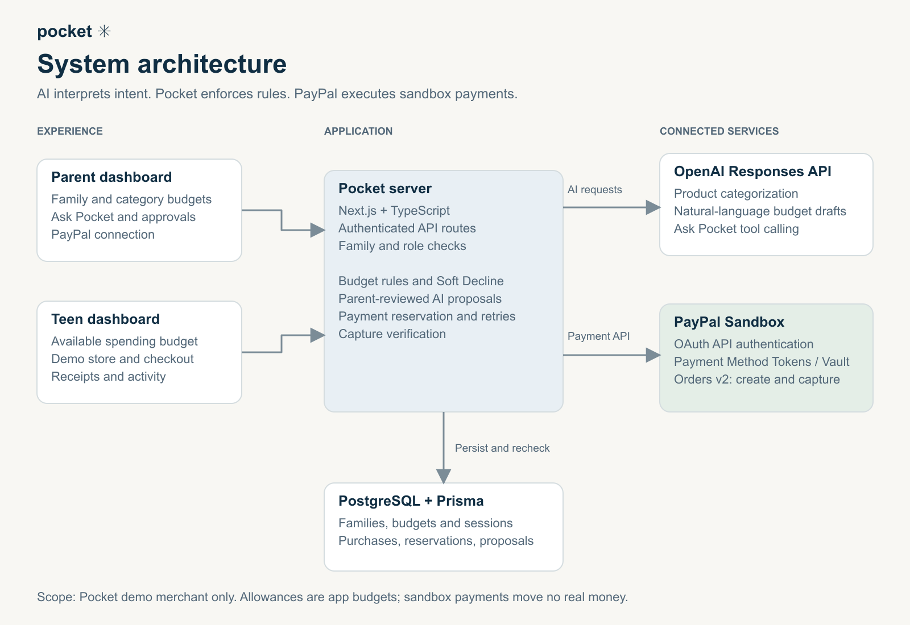
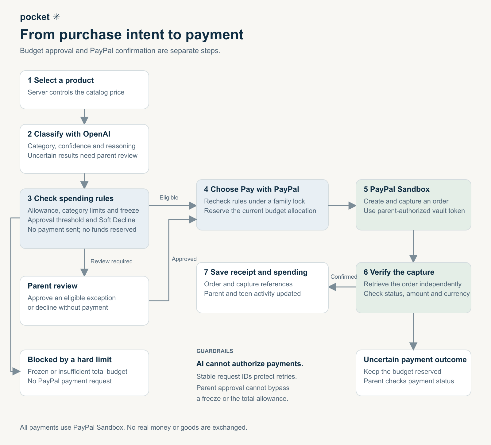

## Inspiration

Kids learn to manage money by making decisions, but parents need a way to give them independence with boundaries they can trust. We built Pocket around a simple question: **What if an allowance came with guidance built into every purchase?**

Combining PayPal with AI let us explore that idea: parents describe their spending rules in everyday language, and kids practice making choices within those boundaries.

## What it does

Pocket is a parent-guided spending app that brings together AI-powered budgeting and PayPal checkout.

Parents can create a family, invite their children, set allowances and category budgets, review purchase requests, and freeze spending. AI turns plain-English instructions into budget drafts that parents review and save.

Kids get their own dashboard to see their available budget, browse a demo store, and make purchase decisions. AI classifies products into spending categories so Pocket can apply the relevant rules. Low-confidence classifications require parent approval.

PayPal is central to the purchase flow. Parents connect a PayPal account, and eligible purchases use that connection through the demo merchant. **The prototype uses PayPal’s sandbox environment**, so it demonstrates the payment flow without moving real money.

## How we built it

We built Pocket with **Next.js, TypeScript, PostgreSQL, and Prisma**, with separate experiences for parents and children.

We integrated **PayPal OAuth, payment vaulting, and Orders v2** to connect a parent’s sandbox account and support subsequent purchases. On the server, Pocket checks budgets, reserves the purchase amount, and tracks payment outcomes.

We used the **OpenAI Responses API with structured outputs** for product classification and natural-language budget drafting. AI helps interpret intent; application code enforces spending limits. Parents explicitly save budget drafts before they take effect.

### System architecture

_Parent and teen dashboards connect to Pocket’s server, which enforces spending rules, stores data in PostgreSQL through Prisma, and integrates with OpenAI and PayPal Sandbox._

### Purchase flow

_Each purchase moves through AI categorization and server-side budget checks before payment. Parent review handles exceptions, and a verified PayPal capture confirms a completed purchase._

## Challenges we ran into

The hardest part was coordinating a budget decision with an external payment. Two purchases arriving together must not spend the same remaining allowance, and retrying a request must not create a duplicate charge. We addressed this with database-backed reservations, duplicate-request protection, and stable PayPal request IDs.

We also had to handle uncertain payment outcomes. If a response is interrupted, Pocket keeps the amount reserved and lets the parent check the payment’s status before releasing it.

Another challenge was deciding how much authority to give AI. Product categories can be ambiguous, and a suggested budget may need adjustment. We built review steps around those uncertainties instead of treating every AI response as a final decision.

## Accomplishments that we're proud of

We’re proud of connecting the full journey: a parent creates a family, invites a child, sets spending rules, connects PayPal, and gives the child room to make purchase decisions.

We also built safeguards beneath that experience, including server-controlled prices, family isolation, spending freezes, and protection against duplicate purchases. Our automated tests cover budget rules, permissions, and concurrent purchase requests.

Most of all, we’re proud that both integrations have a clear purpose: **AI helps families express and interpret spending rules, while PayPal powers the payment flow.**

## What we learned

We learned that a spending limit is more than a number on a dashboard. It must remain reliable when requests overlap, payments fail, or someone retries a purchase.

We also learned that AI is most useful here when its role is clearly defined. It can translate everyday language into structured suggestions, while explicit rules and parent approval govern what happens next.

Building Pocket reinforced how much trust depends on clarity: children need to understand their available budget, and parents need to understand what they have authorized.

## What's next for pocket

Our next step is to strengthen Pocket for a broader pilot: improve account recovery and invitation delivery, add payment webhooks, and make payment reconciliation more automatic.

We also want to expand the learning experience with age-appropriate explanations, savings goals, and insights that help families discuss spending decisions.

Longer term, we want to explore additional merchant experiences and a path toward production payments, subject to PayPal’s requirements. Our goal is to help kids gain practical money skills while giving parents clear, meaningful control.
